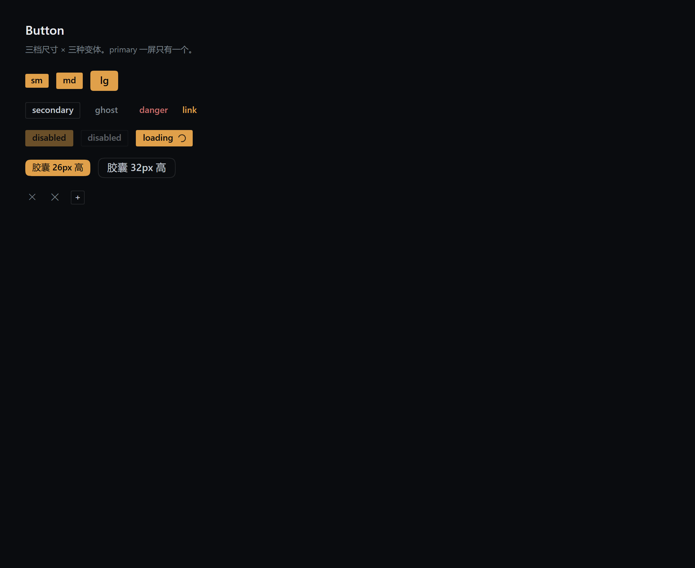
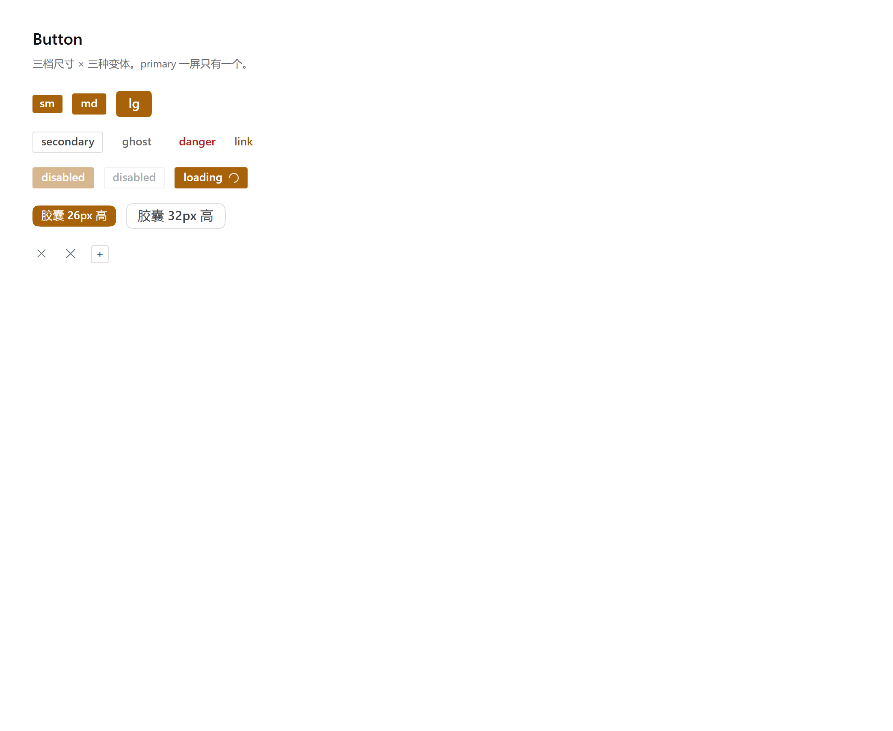
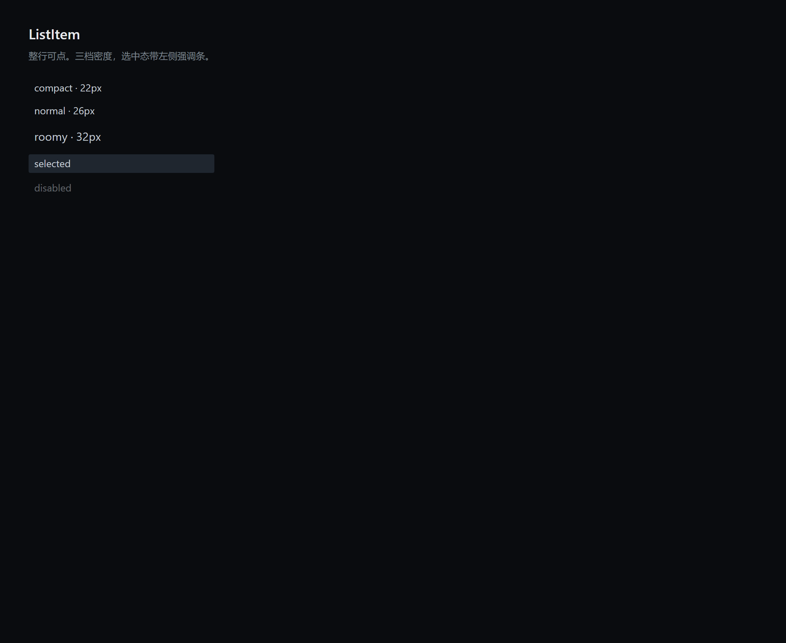
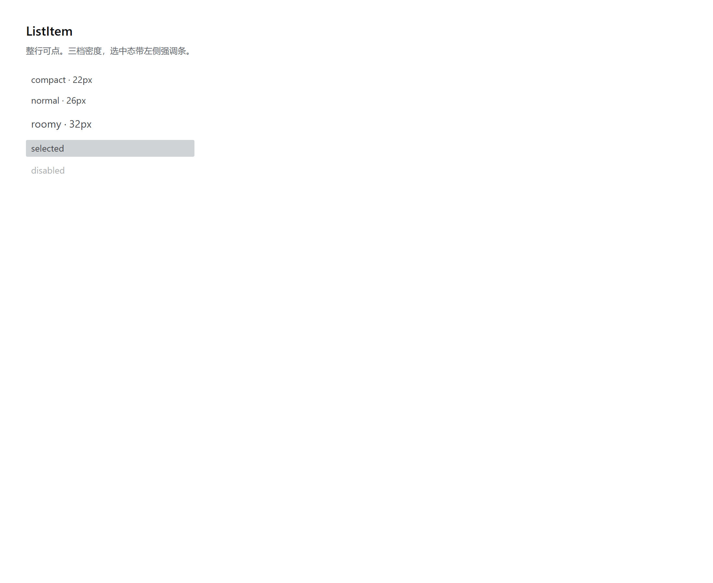
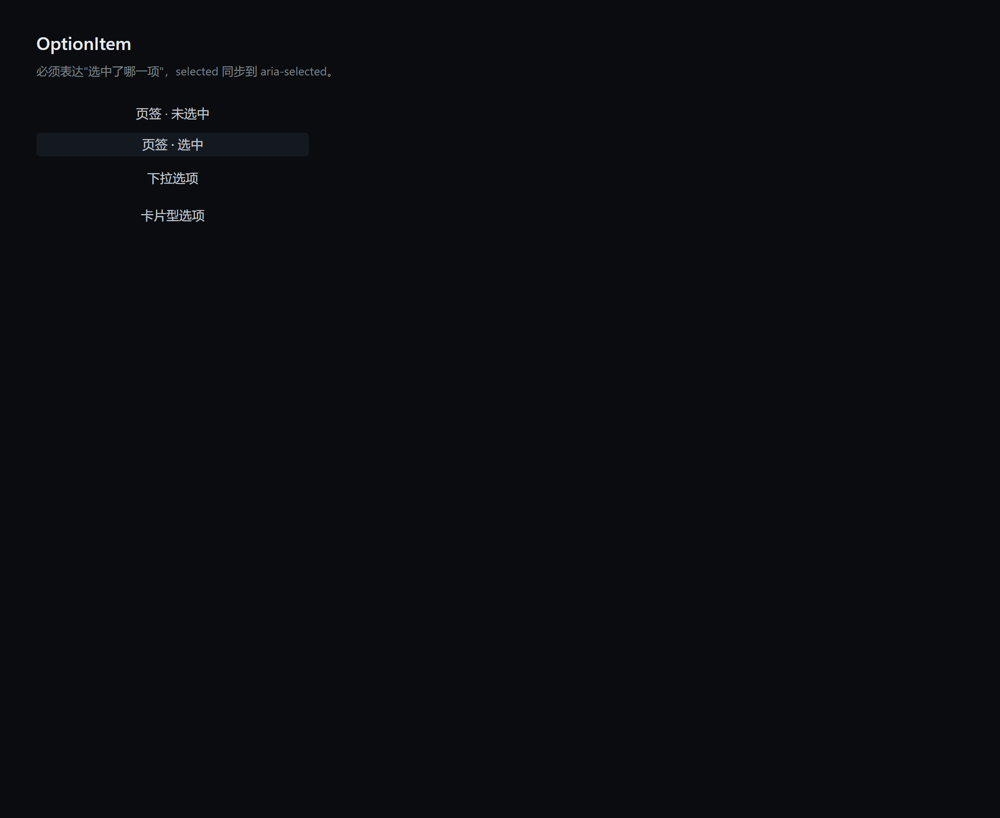
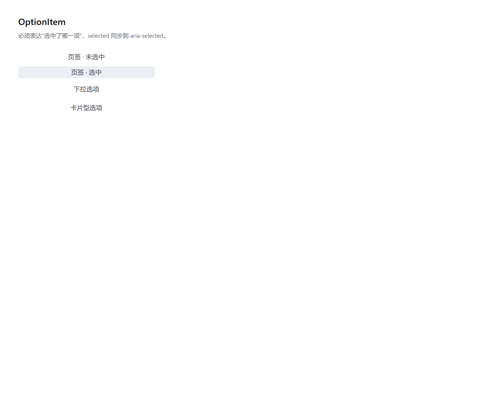
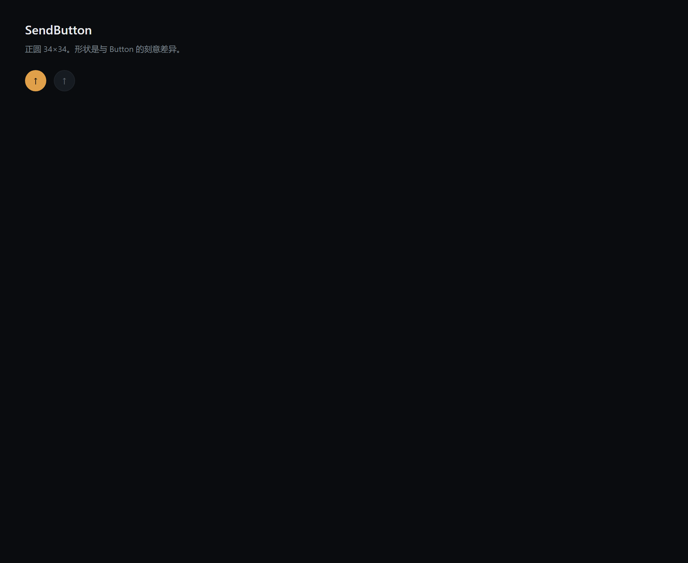
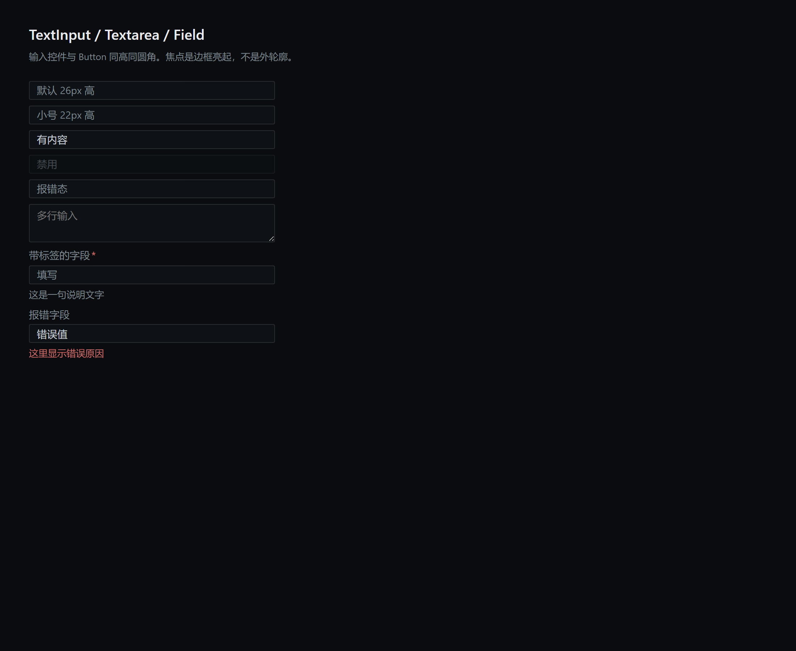
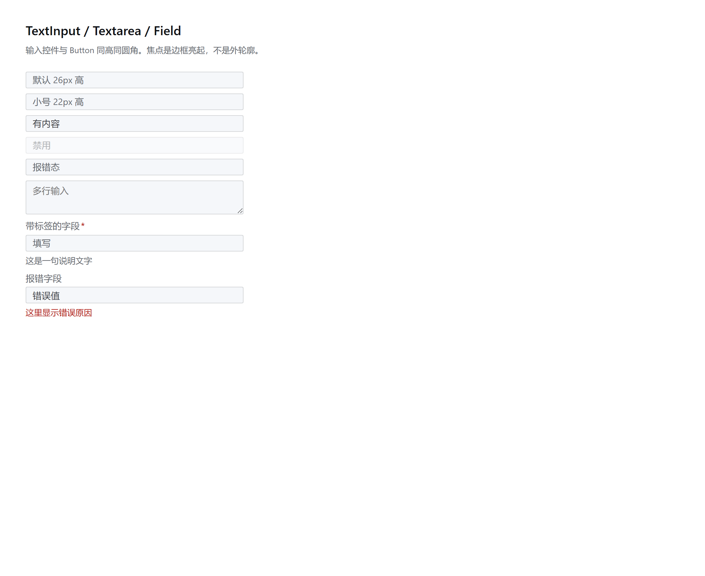

# 界面开发手册

> 写于 2026-11-17，对应 v0.118.2。
>
> **这份文档回答一个问题：要改界面，具体怎么改、怎么验、怎么不把别处弄坏。**
>
> 配套文档：控件清单与尺度表见 [control-spec.md](control-spec.md)。
> 本文是"操作手册"，那份是"规范说明"。
>
> **为什么这么设计、别人怎么做的、Agent 界面常踩的坑** → [design-research/](design-research/README.md)。
> 那套资料里有 22 个常见问题和 10 个待办（UD-01~10），可以和本文的 P0/P1/P2 并行推进。

---

## 目录

1. [这份文档怎么用](#1-这份文档怎么用)
2. [现状地图](#2-现状地图)
3. [设计令牌全表](#3-设计令牌全表)
   - [3.9 控件规格：总览](#39-控件规格总览)
   - [3.10 Button](#310-button) · [3.11 ListItem](#311-listitem) · [3.12 OptionItem](#312-optionitem)
   - [3.13 SendButton](#313-sendbutton) · [3.14 Field + Input](#314-field-input)
   - [3.15 控件层的边界](#315-边界控件层管什么不管什么) · [3.16 文字截断](#316-文字截断)
4. [打磨清单](#4-打磨清单)
5. [改造流程](#5-改造流程)
6. [验收命令与判据](#6-验收命令与判据)
7. [常见坑](#7-常见坑)

---

## 1. 这份文档怎么用

### 1.1 前提

本次改造的范围是：**总体布局不变，打磨组件细节。**

所以：

- ✅ 允许：调间距、行高、内边距、圆角、过渡、空态、图标对齐、暗色/亮色对比
- ❌ 不允许：改三栏结构、改导航层级、推倒重写、换配色体系

> 历史教训：2026-11-15 试过"推倒重来"（提交 `18bbf66`），
> 结果是整页还原。原因不是布局错了，是**细节没打磨好**。

### 1.2 改之前必读的三件事

1. **先看第 4 章的打磨清单**——你的问题多半已经在里面，有现成结论
2. **再看第 5 章的流程**——五步走完，不许跳
3. **最后看第 7 章的坑**——每一条都真实踩过

### 1.3 一句话原则

> **改一个组件，只动一个组件。**
> 如果一次改动需要动 3 个以上文件，停下来重新划范围。

---

## 2. 现状地图

### 2.1 界面骨架

```
┌──────────────────────────────────────────────────────────────┐
│ TitleBar（自绘，30px，含窗口按钮 WindowButton）                 │
├──────────┬────────────────────────────────┬──────────────────┤
│          │                                │                  │
│ Sidebar  │ 主区                            │  RightRail       │
│ 244px    │ ├ Conversation  对话            │  320px           │
│ 可拖     │ ├ NewSession    新会话          │  可拖            │
│ 可折叠   │ ├ GlobalAssistant 跨项目指路    │  可折叠          │
│          │ ├ TraceView     轨迹            │  页签：待办/改动  │
│          │ └ ChangePage    改动            │         /文件     │
│          │                                │                  │
├──────────┴────────────────────────────────┴──────────────────┤
│ 浮层：CommandPalette（Ctrl+K）/ SettingsDialog（Ctrl+,）       │
│       Onboarding / 各种 Picker / 右键菜单                     │
└──────────────────────────────────────────────────────────────┘
```

- 布局：`app-shell` 用 CSS Grid，列宽由 `App.tsx` 内联 `gridTemplateColumns` 控制
- 侧栏宽度存 `localStorage`（`sidebarWidth.ts`），右栏宽度在 `App.tsx` 里固定 320
- 折叠时整块 `display: none`，不是缩到 0 宽

### 2.2 每个视图在哪个文件

| 视图 | 文件 | 说明 |
| --- | --- | --- |
| 整体框架 | `App.tsx` | 路由、状态、布局网格 |
| 对话 | `components/Conversation.tsx` | 消息流 + 输入区 |
| 新会话 | `components/NewSession.tsx` | 空态 + 项目选择 |
| 跨项目指路 | `components/GlobalAssistant.tsx` | Supervisor 视图 |
| 轨迹 | `components/TraceView.tsx` | 工具调用流水 |
| 改动 | `components/ChangePage.tsx` | diff 汇总 |
| 侧栏 | `components/Sidebar.tsx` | 项目树 + 会话列表 |
| 右栏 | `components/RightRail.tsx` | 多页签 |
| 设置 | `components/SettingsPage.tsx` | 五个分区 |
| 命令面板 | `components/CommandPalette.tsx` | Ctrl+K |

### 2.3 控件层（`src/ui/`）

**所有界面元素都必须从这里拿。** 裸写 `<button>` / `<input>` 会导致测试失败。

| 导出 | 用于 | 详细规格 |
| --- | --- | --- |
| `Button` | 普通动作。变体 `primary` / `secondary` / `ghost` | [§3.10](#310-button) |
| `DangerButton` | 删除、清空、拒绝 | [§3.10](#310-button) |
| `TextButton` | 看起来像链接的按钮 | [§3.10](#310-button) |
| `IconButton` | 纯图标，`label` 必填 | [§3.10](#310-button) |
| `ListItem` | 列表行 / 导航项 | [§3.11](#311-listitem) |
| `MenuItem` | 右键菜单项 | [§3.11](#311-listitem) |
| `OptionItem` | 单选组 / 页签 / 可选中项 | [§3.12](#312-optionitem) |
| `SendButton` | 34×34 正圆发送键 | [§3.13](#313-sendbutton) |
| `WindowButton` | 标题栏最小化 / 最大化 / 关闭 | — |
| `Field` + `TextInput` / `Textarea` | 表单 | [§3.14](#314-field-input) |
| `Select` | 下拉（自绘，不用原生 `<select>`） | — |
| `Text` | 文字容器，`truncate` 自带截断四件套 | [§3.16](#316-文字截断) |

> **规格的唯一来源是代码，不是这份文档。**
> 下面的表格由 `node scripts/extract-specs.mjs` 从 `ui.css` / `styles.css`
> 提取，改代码后请重跑并核对。数字腐烂是这类文档最常见的失效方式。

### 2.4 数据是运行时来的

界面里绝大多数内容不在代码里，是运行时给的：

- 项目列表、会话列表 → `GET /api/projects`
- Agent 状态、进度 → SSE `GET /api/events`
- 消息流 → 事件累积（`state.ts` 的 `applyEvent`）

**含义**：改样式时用真实数据才看得见问题。空数据下不溢出的地方，
填了长项目名就撑破——这正是过去反复出现的 bug。

### 2.5 当前的 CSS 现状

> **2026-11-18 实测**。这些数字会随时间腐烂，以命令输出为准。

| 指标 | 值 | 说明 |
| --- | --- | --- |
| `styles.css` | **6685 行** | 历史遗留：各场景类、一次性样式 |
| `ui.css` | **约 290 行** | **控件层契约**——改控件只看这个文件 |
| 空规则块 | **0** | 已全部删除 |
| 写死的 `font-size` | **0** | 全部令牌化 |
| 写死的 `border-radius` | 1 | 是 `calc()` 计算值，非硬编码 |

#### 为什么拆成两个文件

控件层重做时，每一轮都是"把带说明的规格块追加到 `styles.css` 末尾"。
追加是刻意的——为了避开前 6700 行的 CRLF 混排区（见 [§7.2](#72-stylescss-混排-crlf-与-lf)），
整块重写会产生几百行假 diff。但文件因此涨到 7000+ 行。

现在这些规格块移到了 `ui.css`：

```
main.tsx 里：
  import './styles.css';   ← 历史遗留，先加载
  import './ui.css';       ← 控件契约，后加载（层叠上覆盖前者）
```

**加载顺序决定了层叠结果**，这一点在 [§7.1](#71-改-css-以为生效实际被覆盖) 里详述。

> ⚠️ **注意**：正因为 `ui.css` 后加载，里面写的**每一条规则都会压过
> `styles.css` 里的同名属性**。骨架类尤其要小心：
> `.option-item` 曾经因为写了 `width: 100%` 和 `border-radius`，
> 把场景类的形状全部覆盖掉（见 [§7.9](#79-骨架类覆盖了场景类的形状)）。

---

## 3. 设计令牌全表

**改界面只许用这里的值。** 写死数值会被 `controlSpec.test.ts` 拦住。

### 3.1 字号（4 档）

| 令牌 | 值 | 用在哪 |
| --- | --- | --- |
| `--fs-xs` | 12px × font-scale | 元信息、角标、面包屑 |
| `--fs-sm` | 13px × font-scale | 次要文字、设置项说明 |
| `--fs-md` | 15px × font-scale | **正文**、消息、按钮 |
| `--fs-lg` | 17px × font-scale | 页面标题、对话框标题 |

- 增加了 `--font-scale` 支持（设置里的字号缩放），所以是 `calc()`
- **半像素字号禁止**（11.5 / 12.5），会在任何屏幕上发虚

### 3.2 行高（**本次新增，待落地**）

| 令牌 | 值 | 用在哪 |
| --- | --- | --- |
| `--lh-tight` | 1.4 | 单行标签、表格行、按钮内文字 |
| `--lh-normal` | 1.55 | 正文、消息、说明文字 |
| `--lh-loose` | 1.7 | 长文档、Markdown 正文 |

> 现状是 15 种取值。收敛到 3 档是 P0 打磨项（见 4.1 #1）。

### 3.3 控件高度（3 档）

| 令牌 | 值 | 用在哪 | 当前引用数 |
| --- | --- | --- | --- |
| `--h-sm` | 22px | 小按钮、标签、密集行 | 10 |
| `--h-md` | 26px | 标准按钮、输入框、tab | 12 |
| `--h-lg` | 32px | 主操作按钮 | 4 |

### 3.4 间距（4px 网格）

| 令牌 | 值 | 说明 |
| --- | --- | --- |
| `--g-05` | 2px | 图标与文字之间 |
| `--g-1` | 4px | |
| `--g-15` | 6px | 芯片内边距 |
| `--g-2` | 8px | |
| `--g-25` | 10px | 按钮水平内边距 |
| `--g-3` | 12px | |
| `--g-4` | 16px | |
| `--g-5` | 24px | |
| `--g-6` | 32px | |

**不许出现 5px / 7px / 9px** 这类不在网格上的值。

### 3.5 圆角（6 档，按层级）

| 令牌 | 值 | 用在哪 |
| --- | --- | --- |
| `--r-xs` | 4px | 标签、行内代码、小徽章 |
| `--r-sm` | 8px | 按钮、输入框、下拉 |
| `--r-md` | 12px | 面板、卡片、气泡 |
| `--r-lg` | 16px | 浮层、模态、输入框容器 |
| `--r-xl` | 20px | 大面板、空态容器 |
| `--r-full` | 50% | 圆形图标按钮、发送键 |

### 3.6 动效

| 令牌 | 值 | 用在哪 |
| --- | --- | --- |
| `--dur-fast` | 0.1s | 悬停、按下、颜色变化 |
| `--dur-base` | 0.2s | 展开、淡入 |
| `--dur-slow` | 0.3s | 面板滑入 |
| `--ease` | `cubic-bezier(0.4, 0, 0.2, 1)` | 默认缓动 |

**规则**：
- 状态变化（hover / active / focus）→ `--dur-fast`
- 元素出现/消失 → `--dur-base`
- 面板级滑动 → `--dur-slow`
- **不许用 `linear`**，也不许写 `0.15s` 这类中间值

### 3.7 可读宽度

| 令牌 | 值 | 用在哪 |
| --- | --- | --- |
| `--content-read` | 760px | 消息、文档、输入区 |

- 大屏下正文超过 ~75 字符/行会明显降低阅读速度
- 当前只有 6 处引用，**P0 打磨项要求全覆盖**

### 3.8 颜色（三层，只用语义层）

```
--c-*        原始层：只有这里能写十六进制
--color-*    语义层：只做 var(--c-*) 引用
              （colorDiscipline.test.ts 守卫，写死即失败）
```

常用语义令牌：

| 令牌 | 含义 |
| --- | --- |
| `--color-surface-canvas` | 最底层背景 |
| `--color-surface-sidebar` / `panel` / `raised` | 逐层抬起 |
| `--color-label-primary` / `secondary` / `tertiary` | 文字三级 |
| `--color-border-divider` / `strong` | 分割线 |
| `--color-action` / `--color-action-text` | 主色填充 / 主色文字（**两者不同**） |
| `--color-danger` / `--color-success` / `--color-warn` | 功能色 |

> ⚠️ `--color-action` 是**填充色**（要亮，压白字），
> `--color-action-text` 是**文字色**（要暗，压浅底）。
> 混用会导致对比度不达标——这个 bug 犯过（亮色下 3.66:1）。

---

### 3.9 控件规格：总览

控件层有 **5 个基础控件**，围绕它们再派生 7 个专用控件。
所有控件的尺寸只从三档里选，不允许中间值。

| 控件 | 尺寸档 | 高度 | 字号 | 圆角 |
| --- | --- | --- | --- | --- |
| Button | sm / md / lg | 22 / 26 / 32 | 14 / 14 / 16 | 4 / 4 / 8 |
| IconButton | sm / md | 22×22 / 26×26 | — | 4 |
| ListItem | compact / normal / roomy | 22 / 26 / 32 | 14 / 14 / 16 | 4 / 4 / 8 |
| OptionItem | 由场景类决定 | 通常 26+ | 14 | 4（场景可覆盖） |
| Input | sm / md | 22 / 26 | 14 | 4 |
| SendButton | — | 34×34 | — | 50%（正圆） |

### 三条跨控件的硬规矩

1. **Button 与 Input 同高同圆角。** 一行里同时出现按钮和输入框时，
   它们的顶边、底边、圆角必须对齐。
2. **只有 lg 档用正文级字号**（`--fs-md`）。sm/md 用 `--fs-sm`——
   小控件用大字号会显得笨重。
3. **所有控件 `line-height: 1`**（不含多行内容）。
   否则不同字号档的垂直居中程度不一致，图标和文字中线对不齐。

---

### 3.10 Button

`src/ui/Button.tsx` · 样式在 `ui.css`





### 对外只暴露 3 个变体

| 变体 | 用在哪 | 一屏数量 |
| --- | --- | --- |
| `primary` | 保存 / 确认 / 发送 | **只能一个** |
| `secondary` | 取消 / 关闭 / 返回 | 任意 |
| `ghost` | 展开 / 收起 / 更多 | 任意 |

`danger`（删除）与 `link`（文字按钮）**不在公开面**：
要用必须写 `<DangerButton>` / `<TextButton>` 这些名字。
目的是拦住"随手一个红按钮"——写出这个名字就等于承认它会毁东西。

### 尺寸

| 档位 | 高度 | 内边距 | 字号 | 圆角 | 用在哪 |
| --- | --- | --- | --- | --- | --- |
| `sm` | 22px | 0 8px | 14px | 4px | 工具栏、行内动作 |
| `md` | 26px | 0 10px | 14px | 4px | **默认** |
| `lg` | 32px | 0 14px | 16px | 8px | 主操作、欢迎页 |

### 五种状态

| 状态 | 表现 |
| --- | --- |
| 默认 | 按变体着色 |
| `:hover` | 背景加深一档（`--color-surface-hover`） |
| `:active` | `translateY(0.5px)`——**只位移，不缩放** |
| `:focus-visible` | `outline: 2px` + `offset: 2px` |
| `:disabled` | `opacity: 0.45` + `cursor: not-allowed` |
| `loading` | 保留文字 + 右侧转圈 + `aria-busy` + 自动禁用 |

> **为什么 active 不用 `scale(0.97)`**：缩放在密集工具栏里会让相邻按钮
> 产生错位感。位移只影响自己。

> **为什么 loading 不移除文字**：按钮突然变空白或变成"…"，
> 用户会以为自己点丢了。

### 胶囊形态

```css
.btn--pill { border-radius: calc(var(--h-md) / 2); }        /* 26px 高 → 13px */
.btn--pill.btn--sm { border-radius: calc(var(--h-sm) / 2); }
.btn--pill.btn--lg { border-radius: calc(var(--h-lg) / 2); }
```

**不能用 `border-radius: 50%`**——它的语义是"横半径=宽的一半、纵半径=高的一半"，
只有正方形才是正圆。套在 176×26 的按钮上就是一个明显的椭圆。

---

### 3.11 ListItem

`src/ui/ListItem.tsx`





### 与 Button 的区别不是审美，是语义

| | Button | ListItem |
| --- | --- | --- |
| 占位 | 有内边距的独立控件 | **撑满整行** |
| 对齐 | 居中 | **左对齐**（图标 + 文字） |
| 高度 | 22 / 26 / 32 | 22 / 26 / 32（同三档） |
| 焦点 | 圆角描边 | 整行高亮 |
| 用途 | 触发动作 | **选择一项** |

### 密度档

| 类名 | 高度 | 字号 | 圆角 |
| --- | --- | --- | --- |
| `list-item--compact` | 22px | 14px | 4px |
| （默认） | 26px | 14px | 4px |
| `list-item--roomy` | 32px | 16px | 8px |

### 多行变体必须显式解除固定高度

`.list-item` 有 `height`，那是给**单行**列表项的。
带说明文字的卡片（`onboarding-card` / `rail-empty-card`）内容更高，
继承 26px 会溢出，表现成"图标压着边框、文字偏下"。

```css
/* 这类变体统一在 ui.css 给出骨架 */
.onboarding-card,
.rail-empty-card {
  height: auto;
  min-height: var(--h-lg);
  align-items: center;      /* 多行内容要居中，不是 flex-start */
  line-height: var(--lh-normal);  /* 覆盖 .btn 的 line-height: 1 */
  white-space: normal;      /* 多行要允许换行 */
}
```

> **继承类的四件套**：`height` / `line-height` / `white-space` / `align-items`。
> 单行基类改成多行变体时，这四条几乎都要覆盖。详见 [§7.8](#78-组件继承了不该继承的固定尺寸)。

---

### 3.12 OptionItem

`src/ui/OptionItem.tsx`





### 与 ListItem 的区别

`OptionItem` **一定要表达"选中了哪一项"**，`selected` 会自动同步到
`aria-selected`。`ListItem` 只是"能点的一行"。

### 骨架给骨架，形状归场景

```css
/* ui.css —— 骨架只写公共契约 */
.option-item {
  display: flex;
  gap: var(--g-2);
  width: auto;            /* ← 不写 100% */
  /* border-radius 也不写 */
  font-size: var(--fs-sm);
  line-height: var(--lh-tight);
}

/* 满宽交给场景类 */
.option-item.rail-tab,
.option-item.ui-select-item,
.option-item.template-card,
.option-item.perm-picker-item,
.option-item.model-item,
.option-item.settings-nav-item {
  width: 100%;
}
```

> **踩过两次的坑**：骨架里写 `width: 100%` 会把 `.jump-bottom`（32×32 正圆）
> 拉成整行长条；写 `border-radius` 会压过所有场景类的圆角。
> 原因见 [§7.9](#79-骨架类覆盖了场景类的形状)。

### 有意的例外：`settings-nav-item` 是直角

它是设置页**左侧整列导航**——一列连续条目，不是一张张独立卡片。
加圆角会在条目之间留下锯齿缺口。这是形态差异，不是没统一。

---

### 3.13 SendButton

`src/ui/OptionItem.tsx`（同文件）



**34×34 正圆。** 形状是与 Button 的**刻意差异**：

> 通用按钮是胶囊/矩形语义，套上去会得到 40×26 的椭圆。
> `.send-btn` 自己保证宽高相等 → 正圆。

`aria-label` 必填——纯图标按钮没有名字，读屏用户找不到它。

---

### 3.14 Field + Input

`src/ui/Field.tsx`





### 尺寸

| 档位 | 高度 | 内边距 | 字号 | 圆角 |
| --- | --- | --- | --- | --- |
| `sm` | 22px | 0 8px | 14px | 4px |
| `md` | 26px | 0 10px | 14px | 4px |

**与 Button 完全对齐**——同高、同圆角。

### 焦点用边框，不用 outline

```css
.input:focus,
.input:focus-visible {
  outline: none;
  border-color: var(--color-border-focus);
  box-shadow: 0 0 0 1px var(--color-border-focus);
}
```

> 按钮的焦点是"跳出一个外框"，**输入框的焦点应该是"边框亮起来"**。
> 这是两种语言，混用会让输入区看起来像一堆按钮。

### 报错态

`.field--error` 或 `aria-invalid="true"` 时边框转危险色，焦点时保持危险色。

### `hidden` 必须真的隐藏

输入契约规则写的是 `display: block`，选择器具体度（0,2,1）
**高于** `[hidden]` 的 UA 样式（0,1,0）。所以必须补：

```css
input[hidden],
input[type="file"][hidden],
textarea[hidden] {
  display: none;
}
```

> 不补的话，`<input type="file" hidden>` 会露出浏览器的原生控件——
> 暗色界面上一个白底的"选择文件"，非常突兀。

### Field 负责接线

`Field` 用 render function 而不是直接传 children：

```tsx
<Field label="模型密钥" hint="只保存在本机">
  {(ids) => (
    <TextInput
      id={ids.id}
      aria-describedby={ids.describedBy}
      aria-invalid={ids.invalid}
    />
  )}
</Field>
```

控件的 `id` 要让 `<label for>` 指过去，`aria-describedby` 要指到说明上。
这两根线如果让每个调用方自己接，迟早有地方漏接，读屏用户就读不到报错。

---

### 3.15 边界：控件层管什么，不管什么

| 管 | 不管 |
| --- | --- |
| 尺寸、圆角、字号、行高 | 布局（flex/grid 排布） |
| 五种状态的视觉 | 业务数据从哪来 |
| 无障碍（aria、焦点、键盘） | 动画的具体内容 |
| 子元素的相对位置 | 页面级的留白与分栏 |

**判断标准**：如果一个属性在**任意页面**都应该是同一个值，
它属于控件层；如果它取决于出现在哪个页面，它属于场景类。

---

### 3.16 文字截断

`src/ui/Text.tsx` 的 `truncate` 自带截断四件套：

```css
.truncate {
  min-width: 0;          /* ← 最容易被漏掉的一条 */
  overflow: hidden;
  text-overflow: ellipsis;
  white-space: nowrap;
}
```

> **`min-width: 0` 是必须的**：flex 子项默认 `min-width: auto`，
> 不写这条，后面三条全部失效，长文字会撑破容器而不是显示省略号。

新增会显示用户输入文字的元素时，必须登记到
`apps/web/src/test/overflowCoverage.test.ts` 的 `BOUNDED_TEXTS`，
否则体检不检查它。

---

## 4. 打磨清单

按价值排序。每条都有**现状数据、目标、验证方式**。

### 4.1 P0 —— 结构性问题，先做

#### #1 行高收敛：17 种 → 3 档

| | |
| --- | --- |
| **现状** | 17 种取值（2026-11-17 实测）：`1` `1.3` `1.4` `1.45` `1.5` `1.55` `1.6` `1.625` `1.7` `1.8` `17px` `18px` `20px` `22px` `34px` `var(--lh-normal)` `var(--lh-tight)` |
| **目标** | 全部改为 `--lh-tight` / `--lh-normal` / `--lh-loose` |
| **为什么** | 17 种 = 没有标准。相邻文本块基线会微妙错位，用户说不出哪里不对但就是"不齐" |
| **怎么验** | 见下方「守门写法」——**不能只数 `sort -u` 的行数** |

**守门写法（原判据会误判，已修正）**

原来的判据是「`sort -u` 应只剩 3 行」，这不对：剩 3 行也可能是
`1.4` / `34px` / `var(--lh-normal)` 混着，等于没收敛。正确写法要**同时**断言行数和每行的形态：

```bash
grep -oE 'line-height: *[^;]+' apps/web/src/styles.css | sort -u
# 必须恰好 3 行，且每行都形如 `line-height: var(--lh-*)`
# 任何数字或 px 字面量都算失败
```

#### #2 拆 `.md-body` 的多条规则

| | |
| --- | --- |
| **现状** | 2026-11-17 清理后为 **23 个规则块**（清理前 27 块，其中 2 块是空的）。**注意**：这 23 块大部分服务不同元素（table / th / code / pre / p / li / h1-h4），是正常的，不是同一个选择器被重复定义 |
| **目标** | 每个**选择器**只定义一次；不同元素各留一块 |
| **为什么** | 改样式基本靠猜哪条生效。这是"改一处、乱一片"的直接原因 |
| **风险** | **高**。合并顺序错了会改变视觉，**属性顺序本身也有意义**（后写的胜出） |
| **怎么验** | `node scripts/css-snapshot.mjs before/after/diff` 做计算样式判等——比截图可靠 |

#### #3 合并重复定义的选择器

| | |
| --- | --- |
| **现状（2026-11-17 清理后）** | `.thread-item` 1 处、`.messages` 1 处、`.composer` 1 处、`.composer-box` 1 处、`.project-folder` 1 处、`.workspace-head` 1 处、`.sidebar` 1 处、`.conversation-header` 1 处 |
| **清理前** | 上述各 3~4 处，属性靠"后定义覆盖前定义"才得到最终效果 |
| **目标** | 每个基础选择器 1 处定义（`:hover` / `.active` 等状态另算） |
| **为什么** | 同 #2 |
| **怎么验** | `cssHealth.test.ts` 已守：9 个基础选择器定义次数上限 2 |

**守门写法（原判据有 bug，已修正）**

原来的判据是 `grep -cE '^\.messages([ ,:{]\|$)'`——在 `-E` 模式下
`\|` 是**字面竖线**而不是"或"，所以恒返回 0，而判据写「应为 1」。正确的是单竖线：

```bash
grep -cE '^\.messages([ ,:{]|$)' apps/web/src/styles.css
```

#### #4 可读宽度全覆盖

| | |
| --- | --- |
| **现状** | `--content-read: 760px` 只有 6 处引用 |
| **目标** | 消息流、Markdown 正文、输入区全部套 |
| **为什么** | 大屏下正文横跨 1200px，一行 100+ 字符，扫读困难 |
| **怎么验** | 1440px 宽下截图，正文左右留白应大致对称 |

### 4.2 P1 —— 观感提升

| # | 项 | 现状 | 目标 |
| --- | --- | --- | --- |
| 5 | 列表行高度 | `.list-item` 骨架已统一，但场景类（`nav-item` `thread-item`）仍各写高度 | 场景类只保留缩进/图标尺寸，高度走 `density` |
| 6 | 内边距一致性 | 多处手写 `padding: 6px 10px 4px` 这类值 | 全部改 `--g-*` |
| 7 | 空态 | 有的页面有、有的没有 | 统一 `EmptyState` 组件（图标 + 标题 + 一句说明 + 可选操作） |
| 8 | 加载态 | 无 | 列表类加骨架屏；按钮类加 disabled + 转圈 |
| 9 | 焦点环 | 按钮已统一，图标按钮与输入框各有一套 | 全部 `:focus-visible` + `--color-border-focus` + `outline-offset: -2px` |
| 10 | 过渡一致性 | 有的地方有动画、有的没有 | 按 3.6 的规则补齐 |

### 4.3 P2 —— 细节

| # | 项 | 说明 |
| --- | --- | --- |
| 11 | 数字等宽 | 所有数字（token 数、耗时、计数）加 `font-variant-numeric: tabular-nums`，否则翻页时会跳动 |
| 12 | 长内容截断 | 凡是内容长度不可控的，一律 `Text truncate`；新增的要登记进 `overflowCoverage.test.ts` 的 `BOUNDED_TEXTS` |
| 13 | 模态打开时锁背景 | 打开设置/命令面板时 `body { overflow: hidden }`，防止背景滚动 |
| 14 | 窄宽度降级 | 窗口 < 1000px 时右栏默认收起 |
| 15 | 滚动条对比 | 暗色主题下滚动条要能看清（当前 `rgba(255,255,255,.08)`，偏淡） |

### 4.4 明确不做

| 不做 | 理由 |
| --- | --- |
| 改三栏布局 | 布局是对的（用户确认） |
| 换配色体系 | 三层令牌结构合理，改动风险远大于收益 |
| 引入 UI 框架（shadcn / MUI 等） | 现有组件层已覆盖需求，引入等于重写 |
| CSS-in-JS | 与现有令牌体系冲突 |
| 拆分 `styles.css` 成多文件 | 拆了不解决覆盖问题，只是把问题分散到多个文件 |

---

## 5. 改造流程

**每次改界面都走这五步。少一步都不行。**

### 步骤 1：圈定范围

```
一句话写出要改什么：______________________
列出会动的文件（≤ 3 个）：
  1.
  2.
  3.
```

超过 3 个文件 → **重新划范围**。

### 步骤 2：先写令牌

新的数值先进 `:root`，不要在组件里写死。

```css
:root {
  --lh-tight: 1.4;   /* ← 先定义 */
}

.something {
  line-height: var(--lh-tight);   /* ← 再引用 */
}
```

理由：令牌是唯一的改法入口。写死之后想统一调整得全局搜索。

### 步骤 3：改实现

优先级：

1. **改 `src/ui/` 组件** —— 一处改、全站生效，最安全
2. **改场景类** —— 影响单个页面
3. **改覆盖层** —— 最危险，每次都得查清楚前面有没有同名规则

### 步骤 4：跑验收

```bash
pnpm test        # 逻辑 + 契约（约 30 秒）
pnpm ui:audit    # 真实浏览器视觉体检（需先起服务）
```

两个都必须绿。

### 步骤 5：截图对比

```bash
# 起一个隔离环境的服务（不碰你的真实配置）
HOME=.audit-home node apps/runtime/dist/cli.js --serve --static apps/web/dist --port 47911

# 跑体检，截图落盘
OCX_URL=http://127.0.0.1:47911/ node scripts/audit-ui-structure.mjs
```

截图在 `.ui-shots/structure/`，命名 `structure-<主题>-<视图>.png`。

**只允许出现预期内的差异。** 改了消息气泡却导致设置页变了 → 回滚重来。

---

## 6. 验收命令与判据

### 6.1 命令总表

| 命令 | 验什么 | 通过标准 | 耗时 |
| --- | --- | --- | --- |
| `pnpm typecheck` | 类型 | exit 0 | ~20s |
| `pnpm test` | 运行时 1129 + 界面 911 条（实测 2026-11-17） | 全部 pass | 约 3 分钟 |
| `pnpm ui:audit` | 溢出/遮挡/裁切/对比度/CSS 结构 | exit 0 | ~90s |
| `pnpm check:self` | 跨包断链、脚本引用 | exit 0 | ~10s |
| `pnpm app:build` | 出安装包 | 产物在 `dist-installers/` | ~90s |
| `pnpm app:install` | 装最新包 | 预检全过 + 安装成功 | ~60s |

### 6.2 防退化测试（改了界面必须了解）

| 测试文件 | 拦截什么 |
| --- | --- |
| `uiContract.test.ts` | `ui/` 之外出现裸 `<button>`/`<input>`；手写 `btn--*` 类串 |
| `overflowCoverage.test.ts` | 有界文本缺截断四件套 |
| `themeTriplet.test.ts` | 色板变量在某套主题下缺失 |
| `colorDiscipline.test.ts` | 语义层写十六进制色值 |
| `controlSpec.test.ts` | 字号超出 4 档、半像素字号 |
| `spacing.test.ts` | 间距不在 4px 网格上 |
| `tokens.test.ts` | 颜色值被无意改动 |

### 6.3 只跑一部分

```bash
# 只跑界面测试
pnpm --filter @opencoxswain/web test

# 只跑结构体检（不跑对比度）
OCX_URL=http://127.0.0.1:47911/ node scripts/audit-ui-structure.mjs

# 只检查某个文件是否还有重复定义
grep -cE '^\.md-body([ ,:{]|$)' apps/web/src/styles.css
```

### 6.4 体检覆盖的视图与状态

| 维度 | 覆盖 |
| --- | --- |
| 视图 | 首屏 / 对话 / 侧栏 / 右栏 / 设置 / 命令面板（6 个） |
| 主题 | 暗色 / 亮色（2 个） |
| 界面状态 | 首次配置 / 已配置（2 个） |

合计 **24 种组合**。新增视图时同步加进 `scripts/audit-ui-structure.mjs` 的 `VIEWS`。

---

## 7. 常见坑

### 7.1 改 CSS 以为生效，实际被覆盖

**现象**：改了样式，界面没变，或变了又变回去。

**原因**：`.md-body` 有 27 条规则，你的改动可能被后面第 20 条盖掉。

**防法**：
- 改动前先 `grep -n '^\.xxx' styles.css` 看这个选择器定义了几次
- 改完用浏览器 DevTools 看**计算样式**，不是看源文件
- 优先改 `src/ui/` 组件——那些类基本只有一处定义

### 7.2 `styles.css` 混排 CRLF 与 LF

**现象**：改一行，`git diff` 显示几百行全变了，评审时什么都看不出来。

**数据**：仓库 **615 个文件是 LF、104 个是 CRLF、15 个混排**。

**防法**：

- 用**逐行**方式改（读成行数组，改目标行，写回），不要整文件重写
- 改完看 `git diff --numstat`：删除行数应该接近 0
- **`pnpm check:self` 现在会拦住换行被改的文件**（`scripts/check-eol.mjs`）
- 被拦了就 `node scripts/check-eol.mjs --fix`——它把换行还原成 HEAD 的样子，内容不动

> 2026-11-17 实测：改 `errorDisplay.ts` 时被编辑器转成 CRLF，
> diff 从 56 行变成 175/119。守卫当场抓住，`--fix` 一步还原。

### 7.3 空数据下看不出的溢出

**现象**：开发时一切正常，用户用了几天说"项目名把侧栏撑破了"。

**原因**：测试数据都是短名字，真实项目名可以很长。

**防法**：
- 有界文本一律 `Text truncate`
- 新增有界文本时登记进 `overflowCoverage.test.ts`
- **`min-width: 0` 最容易漏**——flex 子项默认 `min-width: auto`，
  光写 `overflow: hidden` + `text-overflow: ellipsis` 不生效

### 7.4 对比度"看起来还行"

**现象**：文字看着清楚，但自动化检查报 3.43:1（要求 4.5:1）。

**原因**：人眼对低对比度的容忍度比想象的高，但长时间阅读会累。

**防法**：
- 相信 `pnpm ui:audit` 的数字，不信肉眼
- 元信息（`--color-label-tertiary`）最容易踩，它天然比正文暗
- 改颜色后必须跑两种主题

### 7.5 亮色主题才暴露的问题

**现象**：暗色主题一切正常，切到亮色有地方是透明的。

**原因**：亮色主题只覆盖**原始色板**（`--c-*`），
语义层自动跟随。漏定义一个原始色 → `var()` 解析成空值。

**防法**：
- 新增任何 `--c-*` 必须同时在 `:root` 和 `[data-theme='light']` 里加
- `themeTriplet.test.ts` 会拦住

### 7.6 只验证了两个页面

**现象**：改完首页很好看，设置页排版塌了没人发现。

**防法**：
- `pnpm ui:audit` 覆盖 8 视图 × 2 主题 × 2 状态
- 新增视图时同步更新体检脚本

---

### 7.7 测量工具挂了，却当成功用

**现象**：连续几轮"量了数据、确认没问题"，实际审计服务早就停了。
截图全是一张 `ERR_CONNECTION_REFUSED` 错误页，而脚本里
`document.querySelector('.rail')` 返回 null，被当成"这个状态没有右栏"
静默通过。

**这是最坏的一类错误**：比不测更糟——不测你知道自己在猜，
假成功让你以为有证据。

**防法**：

1. **每次测量前先探活**
   ```js
   const res = await fetch(`${BASE}/api/health`).catch(() => null);
   if (!res?.ok) throw new Error('审计服务没起来，先 pnpm runtime --serve');
   ```
2. **对"应该有"的元素做断言，不要静默跳过**
   ```js
   if (cards.length === 0) return 'no cards';  // ← 这行会让错误变成"正常"
   ```
   改成：`assert(cards.length > 0, '右栏应该有卡片，实际 0 个')`
3. **服务用托管后台任务启动**（`run_in_background`），不要 `nohup ... &`——
   后者在会话结束时会被回收，而你不会收到通知

---

### 7.8 组件继承了不该继承的固定尺寸

**现象**：右栏三张功能卡片（图标 + 两行文字）图标压着一条横线、文字偏下。
那条"横线"其实是**卡片边框从图标中间穿过去**。

**根因**：`.rail-empty-card` 是 `.list-item` 的变体，而 `.list-item` 写了
`height: var(--h-md)`（26px），那是给**单行**列表项用的。
卡片实际需要 `padding 12×2 + 图标 26 = 50px`，被按在 26px 里装不下。

**为什么难发现**：`height` 是继承来的，"我写的这条规则里没有 height"
会让人完全想错方向。加上 `align-items: flex-start`，文字块比图标矮，
看上去像"文字偏下"，而不是"卡片装不下"。

**防法**：

1. **变体复用基类时，把基类的固定尺寸显式覆盖掉**
   ```css
   .rail-empty-card {
     height: auto;            /* ← 覆盖继承来的 26px，必须写 */
     min-height: var(--h-lg);
     align-items: center;     /* 多行内容要居中，不是 flex-start */
     line-height: 1.5;        /* 覆盖 .btn 的 line-height: 1 */
     white-space: normal;     /* 多行要允许换行 */
   }
   ```
2. **继承类的四件套**：`height` / `line-height` / `white-space` / `align-items`。
   单行基类改成多行变体时，这四条几乎都要覆盖。
3. **量几何，不要只看截图**：
   ```js
   card.getBoundingClientRect().height            // 实际多高
   icon.top - card.top, card.bottom - icon.bottom // 上下留白是否相等
   ```
   截图里"看起来挤"很难判断是 padding 问题还是高度问题，数字一秒说清。

---

### 7.9 骨架类覆盖了场景类的形状

**现象**：给 `.option-item` 骨架补了公共规格（圆角、宽度）之后，
「回到底部」按钮从小圆点变成了一条横贯对话区的**长条**；
再改圆角，所有页签的圆角又全部消失。

**根因**：`ui.css` 在 `styles.css` **之后**加载。

```
main.tsx:
  import './styles.css';   ← 先加载（场景类在这里）
  import './ui.css';       /* 后加载（骨架在这里）*/
```

CSS 层叠：**具体度相同时，后来者胜**。

`.option-item`（0,1,0）和 `.jump-bottom`（0,1,0）具体度相同，
所以骨架的 `width: 100%` / `border-radius` 一律压过场景类。

**踩了三次**：

| 改动 | 后果 |
| --- | --- |
| 骨架加 `width: 100%` | 32×32 正圆被拉成整行长条 |
| 骨架圆角写 `--r-xs` | 正圆被压成 4px 圆角方块 |
| 骨架圆角改 `0` | 所有场景圆角全归零 |

**防法**：

1. **骨架只写"所有场景都一样"的属性**：`display` / `gap` / `font-size` /
   `line-height` / `color` / `cursor` / `transition`
2. **形状类属性（`width` / `height` / `border-radius`）交给场景类**。
   确实需要统一时，用**场景类列表**显式写：

   ```css
   /* 对，在 ui.css 里列出需要的场景 */
   .option-item.rail-tab,
   .option-item.ui-select-item,
   .option-item.template-card {
     width: 100%;
   }
   ```
   （`.option-item.rail-tab` 具体度 0,2,0，高于单个场景类，不会打架）

3. **改完必须量真实渲染**。这类问题肉眼很难判断——
   "按钮变小了"和"被 CSS 覆盖了"看起来一样。

   ```js
   const el = document.querySelector('.jump-bottom');
   console.log(el.getBoundingClientRect().width, getComputedStyle(el).borderRadius);
   // 32 32 50%  ← 才对
   ```

---

## 附录 A：新增一个组件的检查表

```
[ ] 是否真的需要新组件？（先看 src/ui/ 有没有能复用的）
[ ] 文件放 src/ui/，不在 components/ 里裸写
[ ] 渲染原生控件的次数登记进 uiContract.test.ts 的 expected 表
[ ] 有内容长度不可控的文本 → 用 <Text truncate> 或登记 BOUNDED_TEXTS
[ ] 新颜色 → 写进 :root 和 [data-theme='light'] 两处
[ ] 新间距 → 用 --g-* 令牌
[ ] 焦点态 → :focus-visible + --color-border-focus
[ ] 禁用态 → opacity 0.45 + cursor not-allowed
[ ] pnpm test + pnpm ui:audit 双绿
[ ] 截图对比：只改了该改的地方
```

## 附录 B：改一个已有组件的检查表

```
[ ] grep 确认这个选择器定义了几次（>1 就要小心）
[ ] 改动只涉及 1 个文件
[ ] 没引入新的硬编码数值
[ ] 两种主题都看过了
[ ] 极端数据下看过了（超长名字、零条数据、500 条消息）
[ ] pnpm test + pnpm ui:audit 双绿
```

---

## 附录 C：相关文档

| 文档 | 内容 |
| --- | --- |
| [control-spec.md](control-spec.md) | 控件清单、尺度表、调用方式 |
| [glossary.md](glossary.md) | 命名规范（User / Supervisor / Assistant / Agent） |
