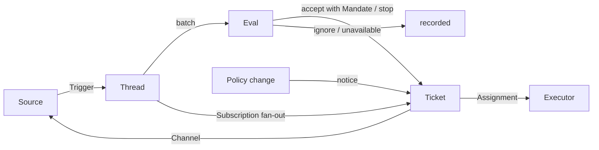

# 001 领域模型

> 本文是 [001 Domain model](001-domain.md) 的中文译文，供阅读参考；如有出入，以英文原文为准。

本文命名 dsh-superagent 的概念，以及每个概念遵守的规则。代码、agent 调用的工具、面板和其他文档都只使用这些术语，不使用别的叫法。遵循 [000 哲学](000-philosophy.md)，本模型只保留工作所必需的概念，一个业务需求则成为其中一个概念的属性。

## 流程

工作从“触发”流向“评估”，再流向执行。来源产生触发。一个触发会以上下文的形式扇出给订阅了它所属线程的工单。通过这种方式抵达某个工单的人的消息留在该工单上；其他所有触发都进入评估，由评估决定它是否在请求新工作。评估接受时，会创建一个带授权的工单。派工把工单交给执行器，结果则通过渠道回到来源。

## 概念

来源、线程、评估、授权和订阅构成核心领域；其余概念为它们提供支撑。

| 概念 | 定义 | 遵守的规则 | 存在的原因 |
| --- | --- | --- | --- |
| 来源（Source） | 一条事件流。来源类型是可复用的实现；来源实例是某个类型的一份配置：是否运行、监听什么 | 保存自己的读取位置和自己的机器人身份。定义什么算一个事件，包括只在一段时间内成立的条件。在机器人的自身消息和监听范围之外的触发进入领域之前就丢弃它们。把每个触发转换成它所属的线程和用于回复的渠道地址 | 重启之后不能重放已处理的事件 |
| 触发（Trigger） | 一个不可变事件，带来源自身的元数据，例如其发起者 | 属于一个或多个线程。同一个触发被接受两次只创建一个工单 | 审计与幂等的单位 |
| 线程（Thread） | 按时间顺序排列的触发；由来源定义哪些触发构成同一个线程 | 同一时刻最多只能有一个评估在它上面运行。它可以有多个工单。它保存自己的订阅、正在运行的评估和决定历史 | 给评估一个一致的视图和它的上下文 |
| 关联（Correlation） | 一个触发所属的多个线程之间的关系 | 只增加上下文；从不决定路由 | 让评估能顺着相关证据追查 |
| 渠道（Channel） | 线程的写入侧；由来源定义其地址 | 一个线程可以有多个渠道；一个工单持有一组渠道 | 确认、回复、PR 和已解决的评审都属于写入 |
| 策略（Policy） | 带版本的评估规则，以及每个来源的那一部分：谁可以通过该来源发起工作、以该来源自己的身份、名单如何同步、哪些机器人可以产生候选 | 策略版本涵盖规则、接受模式和来源部分。影响在途工单的变更（例如它被接受时所依据的某条规则发生变更）会作为输入投递给它的派工；这不会撤销授权。不同来源上的身份永不相互映射 | 规则改变时，正在运行的评估必须被丢弃 |
| 评估（Eval） | 对一批触发的判断，分两层：准入与研判 | 输入：触发批次、线程快照、该线程上的所有工单（含已结束的）以及当前策略。输出：一个决定。不保存状态 | 决定新工作是开始、继续还是停止 |
| 授权（Mandate） | 一次接受所授予的内容：策略版本、范围、强度、匹配的规则、发送者在该来源上的身份，以及来源接收该触发的方式 | 不可变；范围更宽意味着新建一个工单。工单结束不会结束授权：只有人的停止才会撤回它，而不再支持它的策略会撤销它。已结束的工单恢复前会按当前策略重新校验 | 说明这项工作为什么可以做，以及最多能做到什么程度 |
| 工单（Ticket） | 一个已获授权的工作单元 | 只有评估能创建它。引用其授权；持有其渠道和输入。状态从 open → ended，当有人在它的某个线程上发消息使其恢复时回到 open，除非该工单被人停止。它定义自己的状态，而不跟随执行器的状态 | 拥有执行过程及其报告 |
| 派工（Assignment） | 一个工单与一个执行器实例的绑定 | 一个工单在一段时间内会有多个派工。生命周期 pending → running → ended，与工单相互独立。只有它的最终报告可以在执行器一侧结束工单 | 执行器在领域之外，但“谁在执行”必须在领域之内 |
| 订阅（Subscription） | 工单与线程之间的多对多关系，由线程持有 | 匹配的触发会扇出给每一个存活的已订阅工单，不检查发送者是谁；通过这种方式抵达工单的人的消息不进入评估。执行器为获取上下文而跟随的线程以同样方式抵达其工单，但不赋予授权，也不会使工单恢复。已结束的工单保留其订阅，包括已关闭或已合并的 PR 的订阅：人的消息会在同一授权下使其恢复，不经过评估或决定；来自机器人和 CI 的消息不会抵达它，因为执行器恢复时会重新读取其线程。被人停止的工单不接收任何内容。主 Session 只有在消息明确指向某个工单时才把线程挂到该工单上。人可以移除某个线程上的所有订阅；执行器只能移除自己工单对某个被判定为无关的线程的订阅，但工单启动时所在的线程和来源使其跟随的线程（例如它自己的 PR）除外 | 后续讨论无需任何人再次 @ agent 就能抵达执行器 |

“人”不是领域概念。触发按来源给出的形式携带其发起者的标识符。允许名单是策略中某个来源的那一部分，使用该来源的身份。(某一个人在多个来源上都有账号这一事实，是 agent 在需要时读取的提示词文本。)

执行器及其 Session 和目录位于领域之外，通过派工接入。

聚合：来源持有其读取位置。线程持有其订阅、正在运行的评估（串行运行，并把期间到达的触发合并进下一批）和决定历史。工单持有其派工、渠道和输入，并通过 id 引用决定。

## 被否决的概念

| 被否决的 | 原因 |
| --- | --- |
| 把主体（Principal）或成员关系作为实体，或在多个来源之间映射身份 | 一个人是触发的元数据；允许名单是策略中某个来源的那一部分；跨来源映射属于提示词文本 |
| 由评估自行调度延迟触发 | 需要等待的条件就是一个普通来源，因此评估永不反向依赖来源 |
| “等待中”或“已撤销”的评估状态 | 等待属于来源；超时的评估把它的触发重新排队，或以 `unavailable` 结束 |
| 每个线程最多只有一个存活工单 | 一个线程可以承载多项彼此独立的工作；研判通过工单列表避免重复 |
| “追加到工单”的决定 | 追加就是订阅扇出，不需要评估 |
| 对订阅的准入检查 | 订阅覆盖整个线程；授权把“授权”与“上下文”分开 |
| 会决定路由的关联 | 订阅负责路由；关联只增加上下文 |
| 跟随 DSH Session 的工单状态 | 工单可以被移交、恢复或由多个执行器运行，因此它定义自己的状态 |
| 由执行器声明“有人让我停止” | 只有评估决定结束的强度 |
| 策略变更时取消正在运行的工单 | 被取消的变更会留下半途而废的工作；因此变更只被记录并投递 |
| 执行器 Session 失败或阻塞时锁定它的所有工具 | 这会拒绝直接在 Session 中工作的人，也会拒绝恢复后的报告；暂停自动输入就够了 |
| 从报告的自由文本推断“正在等人” | 分类需要结构化事实；执行器通过结构化字段提问 |

## 什么是可复用的

上述概念及其规则是可复用的。来源实现、策略内容、执行器和渠道实现属于某一次部署。每个来源在内部保留自己的措辞（例如“消息”“会话”或“通知”），并把它转换成触发。

| 部分 | 本仓库中的情况 |
| --- | --- |
| 来源 | Feishu：实时事件、历史恢复、订阅话题的轮询。GitHub：通知、已订阅的 Issue 和 PR、CI 变更、已合并或已关闭的 PR，以及在开启时仓库中每个新 Issue、新 PR 和新评论和默认分支的 CI |
| 策略 | 评估规则，以及每个来源的允许名单、同步、机器人名单和准入表 |
| 执行器 | 每个工单一个 DSH 执行器 Session 和一个目录，位于某个执行环境中，其变量由执行器和来源注册 |
| 渠道 | Feishu 话题回复、GitHub 评论和评审线程回复 |

## 术语表

本文及后续文档所用术语的参考清单，附中文名称；上文未介绍过的术语会在后续文档中解释。面板一次只显示一种语言；它的 (?) 按钮会用双语打开这份术语表。agent 在 GitHub 和 Feishu 上发给人的消息使用平实语言，而不用这些术语。

| Term | 中文 | Meaning |
| --- | --- | --- |
| Agent | 智能体 | dsh-superagent 运行的自动化团队成员，通过 GitHub 账号和 Feishu 机器人等身份在来源上行动 |
| Main Session | 主 Session | 评估触发、接受并派发工单并作出回复的 DSH Session；在代码和提示词中叫 `orchestrator` |
| Executor Session | 执行器 Session | 执行器为某个工单运行的 DSH Session；在代码和提示词中叫 `worker` |
| Source | 来源 | 一条事件流：插件提供的一种类型，加上一份实例配置 |
| Trigger | 触发 | 来自来源的一个不可变事件 |
| Thread | 线程 | 按时间顺序排列的触发；评估在其中一次只运行一个的单位 |
| Correlation | 关联 | 共享同一个触发的线程之间的关系；它只增加上下文 |
| Channel | 渠道 | 线程的写入侧 |
| Policy | 策略 | 用于接受工作的带版本规则，以及每个来源的那一部分，例如谁可以在该来源请求工作 |
| Policy version | 策略版本 | 某一组规则、来源部分和接受模式的标识符；每个授权都会记录它 |
| Eval | 评估 | 把一批触发变成一个决定的过程 |
| Gate | 准入 | 评估中确定性的第一层：谁可以发起工作，以及以什么强度 |
| Assessment | 研判 | 评估期间模型的判断 |
| Decision | 决定 | 评估的结果 |
| Mandate | 授权 | 一次接受所授予的内容：强度、范围，以及它所依据的策略版本 |
| Ticket | 工单 | 一个已获授权的工作单元 |
| Assignment | 派工 | 一个工单与一个执行器实例的绑定 |
| Subscription | 订阅 | 工单与线程之间的关系 |
| Fan-out | 扇出 | 把已订阅线程的触发作为上下文投递给工单 |
| Executor | 执行器 | 运行派工的端口：每个工单一个执行器 Session 和一个目录 |
| Execution environment | 执行环境 | 执行器 Session 和 prepare 命令运行的地方：由执行器和来源注册的变量，每个变量有键、值和描述 |
| Report | 报告 | 派工向其工单报告的状态 |
| Attention | 待人工决定 | 工单上等待人回答的问题 |
| Disposition | 去向 | 一个触发被过滤、评估或扇出的记录 |
| Input | 输入 | 投递给工单的上下文：扇出的触发、策略变更、恢复和文本 |
| Scope | 范围 | 授权所允许的工作 |
| Strength | 强度 | 授权或评估的依据有多强 |

| Group | Values |
| --- | --- |
| Decision | accept 接单 · stop 停止 · ignore 忽略 · unavailable 未完成 |
| Strength | explicit 明确 · inferred 推断 |
| Assignment | pending 待启动 · running 执行中 · ended 已结束 |
| Report | progress 进展 · waiting 等待 · ready 就绪 · blocked 受阻 · failed 失败 · dropped 无需处理 |
